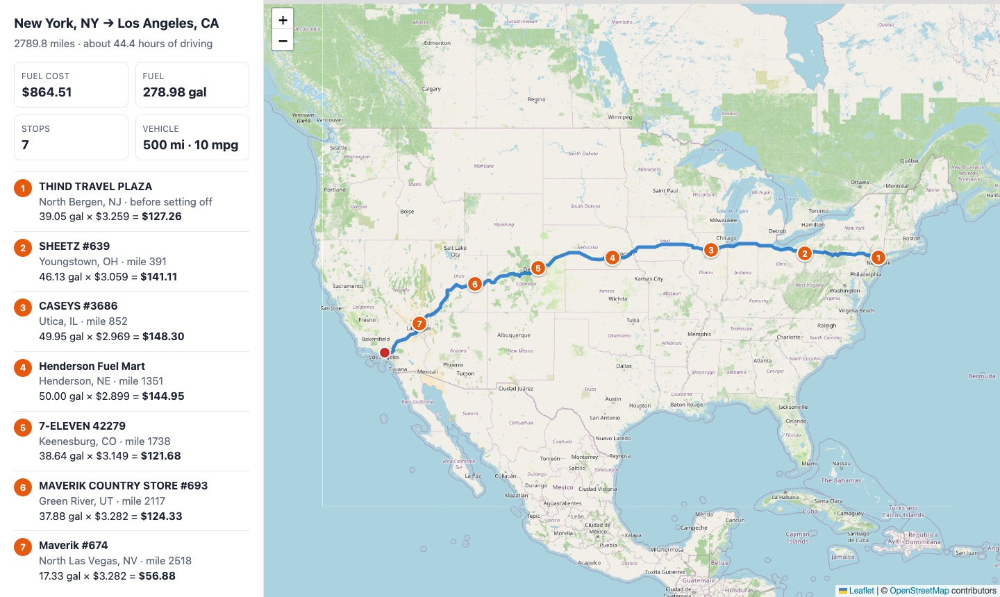
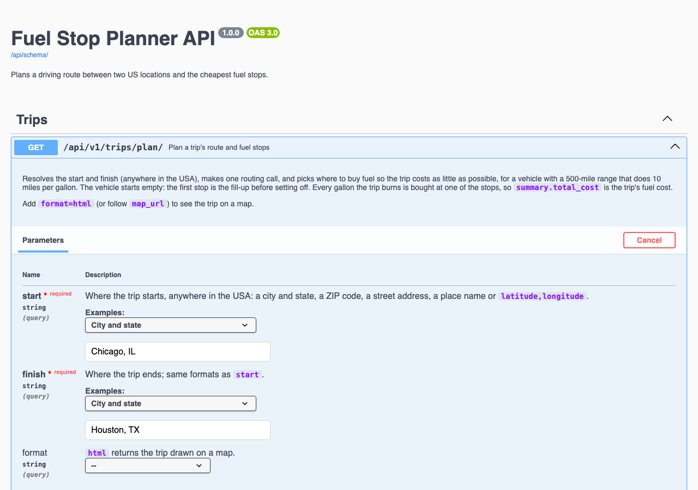

# Fuel Stop Planner

A Django REST API that plans a drive between two places in the USA and chooses where to refuel so the trip costs as little as possible, for a vehicle with a **500-mile range** that does **10 miles per gallon**. It returns the route, the fuel stops, the total fuel cost and a map.



- **One routing call per trip**, none for a trip asked before. Towns, ZIP codes and coordinates are looked up locally.
- **Fast:** 0.2–0.5 s for a new cross-country trip, about 20 ms when it's cached.
- **The cheapest sensible plan,** from an exact optimizer that is checked against brute force.
- **Every gallon is counted:** the trip buys exactly miles ÷ 10 gallons, and the stops add up to the total.

## Run it

You need Python 3.12+ and a free [OpenRouteService API key](https://openrouteservice.org/dev/#/signup).

```bash
git clone https://github.com/aamirshehzad111/fuel-stop-planner.git
cd fuel-stop-planner
cp .env.example .env    # then set ORS_API_KEY
make install            # virtualenv, dependencies, database (about 30 s)
make data               # US towns, ZIP codes and the fuel price list (about 5 s)
make run                # http://127.0.0.1:8000
```

<details>
<summary>Without <code>make</code> (e.g. on Windows)</summary>

```bash
python -m venv .venv
.venv\Scripts\activate              # macOS/Linux: source .venv/bin/activate
pip install -r requirements-dev.txt
python manage.py migrate
python manage.py import_places
python manage.py import_fuel_prices
python manage.py runserver
```
</details>

`make data` reports what it loaded:

```
Loaded 169698 places and 33620 postal codes.
Imported 6594 stations.
Merged 905 duplicate rows (kept the lowest price per station).
Skipped 620 rows outside the US.
Could not place 32 stations in 25 towns: Willow Beach, AZ (3), Mount Nebo, WV (2), ...
```

## Try it

**Postman:** import [`postman/fuel-stop-planner.postman_collection.json`](postman/fuel-stop-planner.postman_collection.json) and run the collection.
- **13 requests:** 7 trips and 6 error cases, each with its own tests.
- **Checks on every trip:** the stop costs add up to the total, the gallons equal miles ÷ 10, and no stop buys more than a tank.
- **Visualize tab:** each trip draws its route, stops and costs.

**Swagger:** <http://127.0.0.1:8000/api/docs/> (`/` redirects there). Pick an example and press **Execute**.



**curl or a browser:**

```bash
curl "http://127.0.0.1:8000/api/v1/trips/plan/?start=Chicago,%20IL&finish=Houston,%20TX"
```

```json
{
  "start": {"query": "Chicago, IL", "label": "Chicago, IL", "latitude": 41.85003, "longitude": -87.65005},
  "finish": {"query": "Houston, TX", "label": "Houston, TX", "latitude": 29.76328, "longitude": -95.36327},
  "route": {"distance_miles": 1080.5, "duration_hours": 17.7,
            "geometry": {"type": "LineString", "coordinates": [[-87.6501, 41.85003], "..."]}},
  "fuel_stops": [
    {"sequence": 1, "departure": true, "route_mile": 0.0, "distance_from_route_miles": 0.0,
     "price_per_gallon": 3.399, "gallons": 31.62, "cost": 107.48,
     "station": {"id": 73127, "name": "Gas N Wash", "address": "I-55, EXIT 285", "city": "Chicago", "state": "IL", "...": "..."}},
    {"sequence": 2, "departure": false, "route_mile": 316.2, "distance_from_route_miles": 1.4,
     "price_per_gallon": 2.929, "gallons": 47.78, "cost": 139.95,
     "station": {"id": 69861, "name": "HUCKS FOOD & FUEL #379", "city": "Marion", "state": "IL", "...": "..."}},
    {"sequence": 3, "departure": false, "route_mile": 794.0, "distance_from_route_miles": 2.8,
     "price_per_gallon": 2.85733333, "gallons": 28.64, "cost": 81.83,
     "station": {"id": 72594, "name": "Quiktrip #7900", "city": "Texarkana", "state": "TX", "...": "..."}}
  ],
  "summary": {"stop_count": 3, "total_gallons": 108.04, "total_cost": 329.26, "currency": "USD",
              "miles_per_gallon": 10.0, "range_miles": 500.0},
  "notes": [],
  "map_url": "http://127.0.0.1:8000/api/v1/trips/plan/?start=Chicago%2C+IL&finish=Houston%2C+TX&format=html"
}
```

- **The map:** add `&format=html`, or open `map_url`.
- **Timing:** every successful response has a `Server-Timing` header showing where the time went.
- **What `start` and `finish` accept:**
  - a city and state: `Chicago, IL`, `chicago, illinois` or `Chicago IL`
  - a ZIP code: `10001`
  - a street address: `1600 Pennsylvania Ave NW, Washington, DC`
  - a place name: `New York`
  - coordinates: `41.8781,-87.6298`

**Errors** are [RFC 9457](https://www.rfc-editor.org/rfc/rfc9457) problem details with a stable `code`:

```json
{"type": "about:blank", "title": "Unprocessable Content", "status": 422, "code": "location_outside_usa",
 "detail": "'Toronto, ON' (Toronto, ON, Canada) is outside the USA. Only trips within the USA can be planned. If you meant a US town, add its state, e.g. 'Springfield, IL'.",
 "instance": "/api/v1/trips/plan/"}
```

| Status | `code` |
|---|---|
| 400 | `invalid_request` (names each bad parameter), `same_location` |
| 422 | `location_not_found`, `location_outside_usa`, `route_not_found`, `no_fuel_plan` (gives the miles with no station) |
| 429 | `throttled` (more than 60 requests a minute from one client) |
| 502 / 503 / 504 | `routing_failed` / `routing_unavailable` (missing key, quota, rate limit) / `routing_timeout` |
| 503 | `fuel_prices_not_loaded` (`make data` was skipped) |

## How a trip is planned

1. **Resolve the two places.** Coordinates, ZIP codes and city-and-state are looked up locally, among 169,698 towns and 33,620 ZIP codes. Anything else (a bare name, an address) goes to the OpenRouteService geocoder: one call, cached.
2. **Route.** One OpenRouteService call returns the distance, the driving time and the path. It's cached for a day.
3. **Find the stations near the route.**
   - One indexed query fetches the stations in the route's bounding box.
   - The route, with a point every quarter mile, goes in a k-d tree. One lookup then gives each station its milepost and its distance from the route.
   - Stations within 5 miles count, keeping the cheapest in each town.
4. **Choose the stops.**
   - **The insight:** at each stop an optimal plan either fills the tank or buys just enough to reach the next stop.
   - **The algorithm:** a dynamic program over those few cases finds the exact optimum of the fuel bill plus $10 per stop, in about 20 ms.
   - **The proof:** tests compare it with brute force (every set of stops, solved as a linear program) on 300 random trips.
5. **Respond.** Money is computed in `Decimal`, and the route line is simplified to about 100 m.

## Decisions

| Decision | Why |
|---|---|
| The vehicle starts empty, so stop 1 is a fill-up at the first station on the route, normally in the start town | "Total money spent on fuel" covers the whole trip: gallons = miles ÷ 10, and the stops add up to the total |
| Each stop counts as **$10** when choosing stops, never in the reported cost | Roughly the driver's and truck's time for a 15–20 minute stop. Without it the cheapest plan makes 18 stops coast to coast, some for 0.06 gallons (table below) |
| Stations are placed at their town's center, and those within 5 miles of the route count | The price list has no coordinates. This places 99.5% of US stations |
| The town list comes from Census; town centers come from USGS | Census points are area centroids. San Francisco's is in the Pacific, pulled out by the Farallon Islands |
| Repeated station IDs keep the lowest price; Canadian rows are skipped | The data has 905 repeats and 620 Canadian rows; trips are within the USA |
| A short trip with no station on the way gets one fill-up priced at the nearest listed station, with a note | For example Los Angeles → San Diego: a priced plan beats an error |
| The geocoder searches worldwide, but a US match is preferred when it fits as well as the top result | "Toronto, ON" is rejected as outside the USA; "LA" means Los Angeles; a bare "Paris" means Paris, TX, and the label says so |
| Errors are problem details; responses are JSON unless `format=html` asks for the map | One error shape for clients; browsers see the same JSON as Postman |

The per-stop cost, measured on real routes:

| Trip | $0 per stop | $5 per stop | **$10 per stop** |
|---|---|---|---|
| New York → Los Angeles | 18 stops, $853.05 | 8 stops, $858.65 | **7 stops, $864.51** |
| Seattle → Miami | 20 stops, $1,013.72 | 9 stops, $1,021.67 | **8 stops, $1,029.67** |
| Chicago → Houston | 11 stops, $317.68 | 4 stops, $319.84 | **3 stops, $329.26** |

At $10, a plan buys only a few gallons at the start (to reach a cheaper station nearby) only when that saves more than $10, and a note explains it, e.g. *"Only 4.12 gallons are bought at QUIKTRIP #1036 in Charlotte, NC, at the start: just enough to reach Sheetz #838 in Salisbury, NC (mile 41), where fuel is $0.44 a gallon cheaper."* Set `STOP_PENALTY_USD` in `config/settings.py` to `0` for the strictly cheapest plan.

## Performance

Measured on a laptop, against the real OpenRouteService:

| Request | Time |
|---|---|
| A new trip between towns or ZIP codes | 0.2–0.5 s, almost all of it the routing call |
| The same trip again | about 20 ms |
| Planning itself: stations, optimizer and response, cross-country | about 50 ms |
| A bare name or address | plus 0.2–0.7 s per geocoding call (cached for 30 days) |

## Code

```
core/                           coordinates, distances, US border check, domain errors
locations/                      town and ZIP lookup, the chain of input resolvers, data commands
stations/                       price-list import, station queries
routing/  integrations/         the RouteProvider interface; OpenRouteService adapters
planning/                       route corridor, optimizer, fuel plan (plain Python, no Django)
trips/                          the use case (TripPlanner), the API, the map page
data/  postman/  tests/         price list and US place data; Postman collection; 261 tests
```

- **Layers that depend inwards.** `TripPlanner` depends on small interfaces (resolver, route provider, station source). `trips/container.py` is the one place that picks the implementations. Tests swap in in-memory fakes.
- **Patterns where they fit:**
  - *Chain of Responsibility* for reading inputs.
  - *Adapter* for OpenRouteService.
  - *Decorator* for caching.
  - *Repository* for stations.
- **Quality checks:**
  - `make test`: 261 tests, 97% coverage, no network calls.
  - `make lint`: ruff and mypy in strict mode.
  - CI runs both on Python 3.12, 3.13 and 3.14.

## Data and limitations

- **Data:** the provided price list, plus public-domain US Census and USGS town and ZIP data and a Natural Earth US border. `python manage.py build_place_data` rebuilds the place files. Routing and geocoding are by [OpenRouteService](https://openrouteservice.org); map tiles are © [OpenStreetMap](https://www.openstreetmap.org/copyright) contributors.
- **Gaps in the price list:** it has only 16 California stations, all in the south-east of the state. Two kinds of trip pass no station for more than 500 miles and get `no_fuel_plan`: I-5 north of Sacramento (San Francisco → Seattle), and Bay Area trips heading south-east (San Francisco → Houston). A detour through Reno would work, but finding one needs more routing calls.
- **Approximate positions:** stations sit at town centers, so mileposts and distances from the route are approximate.
- **Geocoder quirks:** a few landmarks resolve wrongly, e.g. "Yellowstone National Park". Towns, ZIP codes and addresses are reliable.
- **Free-plan limits:** OpenRouteService allows about 40 routes a minute. Caching and the local lookups keep usage low.
