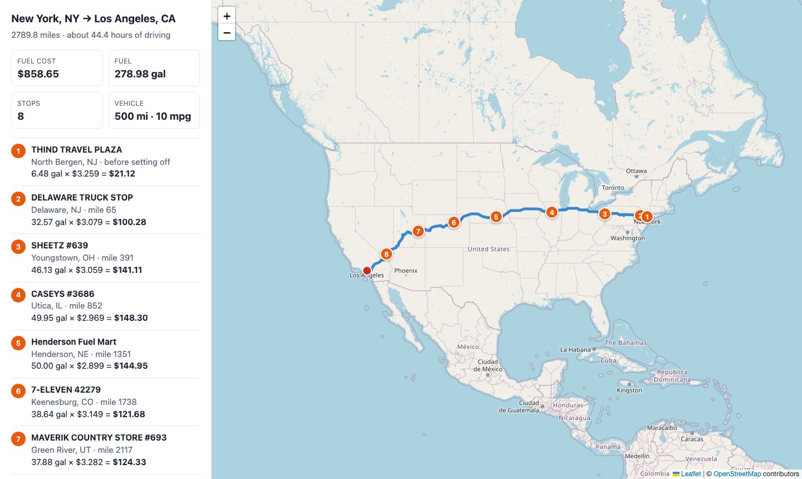

# Fuel Stop Planner

A Django REST API that plans a drive between two places in the USA and chooses where to refuel so the trip costs as little as possible, for a vehicle with a **500-mile range** that does **10 miles per gallon**. It returns the route, the fuel stops, the total fuel cost and a map.



- **One routing call per trip**, none for a trip planned before. Towns, ZIP codes and coordinates are looked up locally; only free text (a street address, a bare city name) needs one geocoding call each.
- **Fast:** 0.2–0.5 s for a new cross-country trip, almost all of it the routing call; about 20 ms when the route is cached.
- **The cheapest plan, without silly stops:** an exact optimizer, checked against brute force, that counts each stop as $5 of the driver's time, so it never stops just to save a few cents.
- **Every gallon is counted:** the trip buys exactly miles ÷ 10 gallons, and the stops add up to the total cost.

## Contents

- [Quick start](#quick-start)
- [The API](#the-api)
- [Postman](#postman)
- [How it works](#how-it-works)
- [Assumptions](#assumptions)
- [Performance](#performance)
- [Design](#design)
- [Data](#data)
- [Configuration](#configuration)
- [Development](#development)
- [Limitations](#limitations)

## Quick start

Requirements: Python 3.13+ and a free [OpenRouteService API key](https://openrouteservice.org/dev/#/signup).

```bash
git clone https://github.com/aamirshehzad111/fuel-stop-planner.git
cd fuel-stop-planner
cp .env.example .env    # then set ORS_API_KEY
make install            # virtualenv, dependencies and database tables
make data               # US towns, ZIP codes and the fuel price list (about 5 seconds)
make run                # http://127.0.0.1:8000
```

`make data` reports what it loaded:

```
Loaded 169698 places and 33620 postal codes.
Imported 6594 stations.
Merged 905 duplicate rows (kept the lowest price per station).
Skipped 620 rows outside the US.
Could not place 32 stations in 25 towns: Willow Beach, AZ (3), Mount Nebo, WV (2), ...
```

Then try a trip:

- JSON: <http://127.0.0.1:8000/api/v1/trips/plan/?start=Chicago,%20IL&finish=Houston,%20TX>
- Map: the same URL with `&format=html`
- Interactive docs (Swagger): <http://127.0.0.1:8000/api/docs/>, which is also where `/` redirects

Use `PYTHON=python3.13 make install` if `python3` is older than 3.13.

## The API

### `GET /api/v1/trips/plan/`

| Parameter | Required | Accepts |
|---|---|---|
| `start` | yes | A city and state (`Chicago, IL`, `chicago, illinois`), a ZIP code (`10001`), a street address, a place name (`New York`) or `latitude,longitude` (`41.8781,-87.6298`) |
| `finish` | yes | The same formats |
| `format` | no | `html` returns the trip drawn on a map |

Response for `start=Chicago, IL&finish=Houston, TX` (route and stops shortened):

```json
{
  "start": {"query": "Chicago, IL", "label": "Chicago, IL", "latitude": 41.85003, "longitude": -87.65005},
  "finish": {"query": "Houston, TX", "label": "Houston, TX", "latitude": 29.76328, "longitude": -95.36327},
  "route": {
    "distance_miles": 1080.5,
    "duration_hours": 17.7,
    "geometry": {"type": "LineString", "coordinates": [[-87.6501, 41.85003], [-87.64984, 41.85238], "..."]}
  },
  "fuel_stops": [
    {
      "sequence": 1, "departure": true, "route_mile": 0.0, "distance_from_route_miles": 0.0,
      "price_per_gallon": 3.399, "gallons": 2.07, "cost": 7.04,
      "station": {"id": 73127, "name": "Gas N Wash", "address": "I-55, EXIT 285",
                  "city": "Chicago", "state": "IL", "latitude": 41.85003, "longitude": -87.65005}
    },
    {
      "sequence": 2, "departure": false, "route_mile": 20.7, "distance_from_route_miles": 1.3,
      "price_per_gallon": 3.079, "gallons": 29.56, "cost": 91.02,
      "station": {"id": 73072, "name": "QUIKTRIP #7204", "address": "I-57, EXIT 337 & SR-50",
                  "city": "University Park", "state": "IL", "latitude": 41.59226, "longitude": -87.68533}
    }
  ],
  "summary": {
    "stop_count": 4, "total_gallons": 108.05, "total_cost": 319.84, "currency": "USD",
    "miles_per_gallon": 10.0, "range_miles": 500.0
  },
  "notes": [],
  "map_url": "http://127.0.0.1:8000/api/v1/trips/plan/?start=Chicago%2C+IL&finish=Houston%2C+TX&format=html"
}
```

- `start.label` / `finish.label`: what each input was understood as.
- `route.geometry`: GeoJSON (`[longitude, latitude]` pairs), simplified to about 100 m, so a cross-country route is about 1,700 points (40 KB).
- `fuel_stops`: in driving order. `route_mile` is how far along the route the station is. The first stop (`departure: true`) is the fill-up before setting off: here 2.07 gallons, just enough to reach the cheaper station 21 miles on.
- `cost`: `gallons × price_per_gallon` in cents. `summary.total_cost` and `summary.total_gallons` are the sums of the stops.
- `notes`: any pricing assumption the plan had to make (see [Assumptions](#assumptions)).
- Every successful response carries a `Server-Timing` header showing where the time went:
  `resolve;dur=5.9, route;dur=0.2, stations;dur=11.9, plan;dur=15.5, serialize;dur=8.8`

### The map

`?format=html` (the `map_url`) draws the same plan on OpenStreetMap with Leaflet: the route, numbered stops and a panel with each stop's price and cost. JSON is the default for every client, browsers included.

### Errors

Errors are [RFC 9457](https://www.rfc-editor.org/rfc/rfc9457) problem details (`application/problem+json`), with a stable `code` for programs and a `detail` for people:

```json
{
  "type": "about:blank",
  "title": "Unprocessable Content",
  "status": 422,
  "code": "no_fuel_plan",
  "detail": "No fuel station from the price list between mile 0 and mile 550 of the route, a stretch longer than the vehicle's 500-mile range.",
  "instance": "/api/v1/trips/plan/"
}
```

| Status | `code` | When |
|---|---|---|
| 400 | `invalid_request` | `start` or `finish` missing, blank or over 200 characters; `errors` names each one |
| 400 | `same_location` | Both resolve to the same place |
| 404 | `not_found` | Unknown `format` |
| 405 | `method_not_allowed` | Anything but `GET` |
| 422 | `location_not_found` | Nothing matches the text |
| 422 | `location_outside_usa` | The place is outside the USA (e.g. `Toronto, ON`); swapped coordinates get a "did you mean" hint |
| 422 | `route_not_found` | No drivable route, or longer than the routing service allows (6,000 km) |
| 422 | `no_fuel_plan` | A stretch of the route longer than 500 miles has no listed station; `detail` gives the miles |
| 429 | `throttled` | More than 60 requests a minute from one client (protects the free routing quota) |
| 500 | `internal_error` | A bug: logged, with no internals in the response |
| 502 | `routing_failed` | The routing service returned an error |
| 503 | `routing_unavailable` | Missing or rejected API key, used-up daily quota, or rate limit (`Retry-After` when known) |
| 504 | `routing_timeout` | The routing service took more than 20 seconds |

## Postman

Import [`postman/fuel-stop-planner.postman_collection.json`](postman/fuel-stop-planner.postman_collection.json), start the server and run the collection (set `baseUrl` if it isn't on `http://127.0.0.1:8000`).

- **Trips:** city and state, coast to coast, ZIP codes, a street address and a bare city name, coordinates, a short trip with no station on the way, and the map page.
- **Errors:** a missing parameter, the same place twice, outside the USA, an unknown place, no station within range, and the wrong method.
- **Tests:** every request has its own. Every trip is also checked to make sure the stop costs add up to the total, the gallons equal miles ÷ 10, no stop buys more than a tank, and each cost is gallons × price. Every error is checked for the problem-details shape.
- **Visualize tab:** each trip draws its route, stops and a cost table.

## How it works

```
start, finish ──► resolve ──► route (1 call) ──► stations near the route ──► choose stops ──► JSON or map
```

1. **Resolve the two places.** A chain of resolvers is tried in order, and the first that recognizes the text wins:
   - `latitude,longitude`
   - a ZIP code, from the local ZIP table
   - `City, ST` or `City, State`, from the local town table (169,698 US places)
   - anything else, through the OpenRouteService geocoder

   The geocoder searches worldwide on purpose, so `Toronto` is found in Canada and rejected rather than silently becoming Toronto, Missouri. Coordinates are checked against the US border.
2. **Route.** One OpenRouteService directions call returns the road distance, the driving time and the path. Routes are cached for a day (keyed by both ends, to about a metre), so asking again costs no call.
3. **Find the stations near the route.**
   - One indexed query fetches the stations inside the route's bounding box.
   - The route is densified to a point every quarter mile and put in a k-d tree, so each station's nearest point on the route (its milepost) and its distance from the route take one nearest-neighbour lookup.
   - Stations within 5 miles count. Stations in the same town share a position, so only the cheapest of them is kept.
4. **Choose the stops.** The vehicle starts with an empty tank and buys every gallon it burns. The objective is the fuel bill plus $5 per stop:
   - **The insight:** in an optimal plan, at every stop the vehicle either fills the tank or buys just enough to reach the next stop. Otherwise, moving fuel to the cheaper of the two stations would save money.
   - **So the states are few:** the fuel on arriving at a station is either nothing, or a full tank minus the distance from an earlier stop.
   - **The algorithm:** a dynamic program over those states finds the exact optimum in O(stations × stations within range), about 20 ms for a cross-country trip.
   - **The proof:** tests compare it with brute force on 300 random trips, solving every possible set of stops as a linear program.
5. **Respond.** Costs are computed with `Decimal` and rounded to cents. The route line is simplified for the response.

**Why $5 per stop?** It was measured on real routes, with stations within 5 miles:

| Trip | $0 per stop | **$5 per stop** | $10 per stop |
|---|---|---|---|
| New York → Los Angeles (2,790 mi) | 18 stops, $853.05 | **8 stops, $858.65** | 7 stops, $864.51 |
| Seattle → Miami (3,319 mi) | 20 stops, $1,013.72 | **9 stops, $1,021.67** | 8 stops, $1,029.67 |
| Chicago → Houston (1,080 mi) | 11 stops, $317.68 | **4 stops, $319.84** | 3 stops, $329.26 |

With no per-stop cost, the cheapest plan stops for as little as 0.06 gallons. At $5 there are half as many stops for under 1% more fuel cost. The $5 only steers the choice of stops; it is never part of the reported cost. Set `STOP_PENALTY_USD` to `0` for the strictly cheapest plan.

## Assumptions

- **The vehicle:** a 500-mile range at 10 mpg, so a 50-gallon tank. It can reach a station or the finish with an empty tank.
- **Starting fuel:** the vehicle starts empty, so the first stop is a fill-up before setting off. It's priced at the first listed station on the route, which is usually in the start town. When that station is more than 25 miles in, a note says so.
- **Short trips with no station on the way** (Los Angeles → San Diego, for example) get one fill-up priced at the nearest listed station, with a note naming it and how far away it is.
- **Station positions:** the price list has no coordinates, so each station is placed at its town's center. This places 99.5% of US stations; the rest are in towns missing or ambiguous in every source. Stations within 5 miles of the route count, and the short detour to reach one isn't added to the distance.
- **Duplicates and Canada:** a station listed more than once keeps its lowest price. Stations in Canadian provinces (620 rows) are skipped, because trips are within the USA.
- **The route:** the fastest car route, as returned by OpenRouteService.

## Performance

Measured on a laptop, against the real OpenRouteService:

| Request | Time |
|---|---|
| A new trip between towns or ZIP codes (e.g. New York, NY → Los Angeles, CA) | 0.2–0.5 s, of which the routing call is 0.2–0.4 s |
| The same trip again | about 20 ms |
| A bare city name or street address | add about 0.2–0.7 s per geocoding call (cached for 30 days) |
| Planning itself (stations, optimizer, response) for a cross-country route | about 50 ms |

## Design

The code is organized in layers that depend inwards. The planning core is plain Python, with no Django or HTTP in it.

```
trips/api        HTTP: view, query validation, serializers, problem details, map renderer
trips/service    The use case: resolve, route once, find stations, plan fuel
planning         Fuel model and algorithms: route corridor, optimizer, plan
locations        Place lookup and the resolver chain        routing   Route and the RouteProvider interface
stations         Price-list import and station queries      integrations/openrouteservice   HTTP adapters
core             Coordinates, distances, US border check, domain errors
```

- **Small interfaces, wired in one place.** `TripPlanner` depends on `LocationResolver`, `RouteProvider` and `StationSource` protocols. `trips/container.py` is the only module that picks the implementations (OpenRouteService, the database, Django's cache). Tests swap in in-memory fakes, and another routing provider would be a new adapter with no changes elsewhere.
- **Patterns where they earn their place:**
  - *Chain of Responsibility*: the location resolvers.
  - *Adapter*: OpenRouteService behind `RouteProvider` and `Geocoder`.
  - *Decorator*: `CachedRouteProvider` and `CachedGeocoder` add caching without the adapters knowing.
  - *Repository*: stations come back as domain objects, not ORM rows.
- **Errors by meaning, not by source.** Domain errors (`DomainError`) and external failures (`ProviderError`) are translated to HTTP in one place (`trips/api/errors.py`).
- **Money in `Decimal`.** Prices keep the price list's 8 decimals, and costs are rounded half-up to cents.

```
config/                         settings (from environment variables), URLs
core/                           geo primitives, domain errors
locations/                      Place and PostalCode models, name matching, resolvers, data commands
stations/                       FuelStation model, price-list parsing and import, repository
routing/                        Route, RouteProvider, route cache
integrations/openrouteservice/  HTTP client, directions and geocoding adapters
planning/                       geometry, corridor, optimizer, fuel plan
trips/                          TripPlanner, the API, the map template
data/                           price list, US places and ZIP codes, US border
postman/                        Postman collection
tests/                          mirrors the packages above
```

## Data

| File | Contents | Source |
|---|---|---|
| `data/fuel_prices.csv` | 8,151 truck-stop prices (as provided) | OPIS price list |
| `data/us_places.csv.gz` | 169,698 US town centers | US Census 2025 Gazetteer (places, county subdivisions) and USGS GNIS populated places, public domain |
| `data/us_postal_codes.csv.gz` | 33,620 ZIP code centers | US Census 2025 Gazetteer (ZCTAs), public domain |
| `data/us_boundary.geojson` | The US border, for the "inside the USA" check | Natural Earth 1:50m, public domain |

`python manage.py build_place_data` rebuilds the three generated files from their sources, and the output is byte-identical when nothing changed. When a name appears more than once in a state, incorporated places win, then Census-designated places, county subdivisions and GNIS. Ambiguous names are dropped rather than guessed. Town centers come from GNIS when it lists the same town, because Census points are area centroids: San Francisco's is in the Pacific, pulled out by the Farallon Islands.

Routes and geocoding: [OpenRouteService](https://openrouteservice.org). Map tiles: © [OpenStreetMap](https://www.openstreetmap.org/copyright) contributors.

## Configuration

Settings come from environment variables, or a `.env` file in the project root:

| Variable | Default | |
|---|---|---|
| `ORS_API_KEY` | (none) | OpenRouteService key; without it, trips return 503 `routing_unavailable` |
| `DJANGO_SECRET_KEY` | (none) | Required unless `DJANGO_DEBUG=true` |
| `DJANGO_DEBUG` | `false` | |
| `DJANGO_ALLOWED_HOSTS` | `localhost,127.0.0.1` | |
| `DATABASE_URL` | `sqlite:///db.sqlite3` | Any database Django supports, e.g. `postgres://...` |
| `CACHE_URL` | `locmemcache://` | Use a shared cache such as `redis://localhost:6379/0` with several processes |
| `API_RATE_LIMIT` | `60/minute` | Per client |
| `LOG_LEVEL` | `INFO` | |

The vehicle and planning settings (range, mpg, 5-mile station distance, $5 per stop) are in `FUEL_PLANNER` in `config/settings.py`.

## Development

```bash
make test     # 236 tests with coverage (97%)
make lint     # ruff, ruff format --check, mypy (strict)
make format   # fix lint issues and format
```

The tests make no network calls: HTTP is mocked with recorded OpenRouteService responses, and the API tests run the real planner against in-memory places, routes and stations. GitHub Actions runs lint, type checks, a migrations check and the tests on Python 3.13 and 3.14 for every push and pull request.

## Limitations

- **Sparse price list:** some routes can't be fuelled from it. San Francisco → Seattle along I-5 has no listed station for its first 550 miles (its 16 California stations are all in the far south of the state), so it returns `no_fuel_plan`. A detour through Reno and Madras, OR would work (934 miles instead of 816). Finding such detours automatically would need a second routing call through chosen stations.
- **Station positions are town centers,** so the distance from the route and the mileposts are approximate, to within a few miles in large cities.
- **Free-tier quotas:** OpenRouteService's free plan has daily and per-minute limits ([plans](https://openrouteservice.org/plans/)). Caching, local lookups for towns and ZIP codes, and the rate limit keep usage low.
